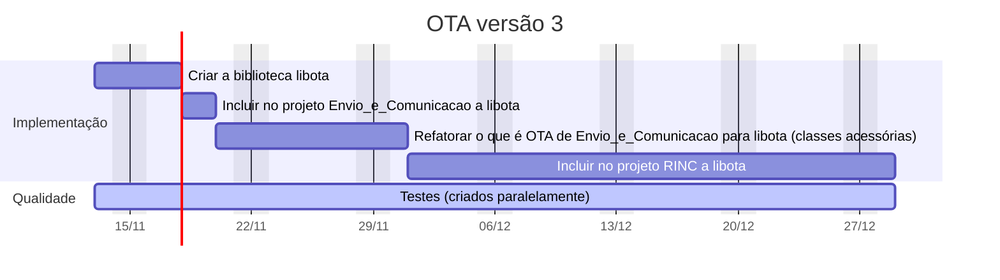

# OTA versão 3

## Implementação
### Criar a biblioteca libota [3 dias]
### Incluir no projeto Envio_e_Comunicacao a libota [2 dias]
### Refatorar do projeto Envio_e_Comunicacao o que é OTA para a libota : classes acessórias estarão dentro da libota [7 dias]
### Incluir no projeto RINC a libota [20 dias]

## Testes são criados paralelamente ao desenvolvimento

